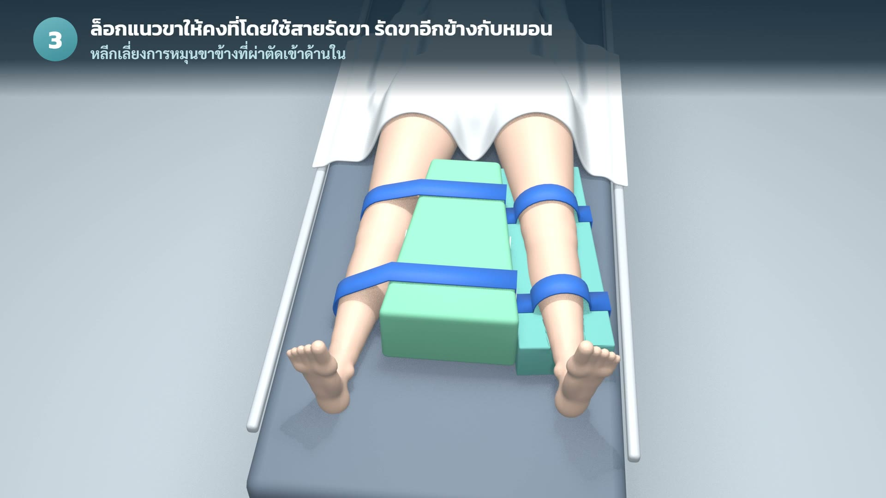

# Hip B(Lock) Ultra Smooth · CQI

นวัตกรรมป้องกันข้อสะโพกเทียมเคลื่อนหลุดหลังผ่าตัด
หลักสูตรเฉพาะทางการพยาบาลปริศัลยกรรม ปีการศึกษา 2569

## 🖥️ สไลด์นำเสนอ

### 👉 [เปิดสไลด์นำเสนอ (ออนไลน์)](https://kttwatt.github.io/cqi-hipblock/)

เปิดได้ทุกเครื่องโดยไม่ต้องเข้าสู่ระบบ · กด → / คลิก เพื่อเปลี่ยนสไลด์ · กด F เพื่อเต็มจอ
(ต้นฉบับที่แก้ไขได้อยู่ใน [Claude Slides](https://claude.ai/artifact/EXST25rBQjPgekQnR5XE57); สร้างหน้าเว็บใหม่ด้วย `python slides-web/build.py <โฟลเดอร์ไฟล์สไลด์>`)

สไลด์มีทั้งหมด 35 หน้า แบ่งเป็น 5 ส่วน:

| ส่วน | เนื้อหา |
|---|---|
| 1 | ผู้จัดทำ และที่มาของปัญหาข้อสะโพกเทียมเคลื่อนหลุด |
| 2 | วัตถุประสงค์ และทฤษฎีที่นำมาใช้ |
| 3 | วัสดุ งบประมาณ และขั้นตอนการดำเนินงานแบบ PDCA |
| 4 | การประดิษฐ์ และการใช้งานหมอน |
| 5 | ผลลัพธ์ การพัฒนาต่อ และสรุป |

## 🎬 วิดีโอและภาพที่ใช้ในสไลด์

| สไลด์ | ไฟล์ | รายละเอียด |
|---|---|---|
| หน้า 3 | [video/renders/final.mp4](video/renders/final.mp4) | วิดีโอเปิดเรื่อง "หมอนกางขาที่หายไป" (55 วินาที) |
| หน้า 28 | [video/renders/usage/usage-steps.mp4](video/renders/usage/usage-steps.mp4) | แอนิเมชัน 3 มิติ 5 ขั้นตอนการใช้งาน (Blender) |
| หน้า 29 | [hipblock/video/assets/media/xray-film.jpg](hipblock/video/assets/media/xray-film.jpg) | ฟิล์มเอกซเรย์หลังจัดท่าด้วย Hip Block |
| หน้า 34 | [hipblock/HipBlock-UltraSmooth-CQI.mp4](hipblock/HipBlock-UltraSmooth-CQI.mp4) | วิดีโอ CQI Hip B(Lock) Ultra Smooth (49 วินาที) |

## 🛠️ ไฟล์สร้างแอนิเมชัน (หน้า 28)

- `video/blender/place.py` ฉากผู้ป่วยกับ Hip B(Lock) ใน Blender
- `video/blender/usage.py` แอนิเมชัน 5 ขั้นตอน (Blender 5.2)
- `video/tools/usage_captions.py` ใส่คำบรรยายภาษาไทย
